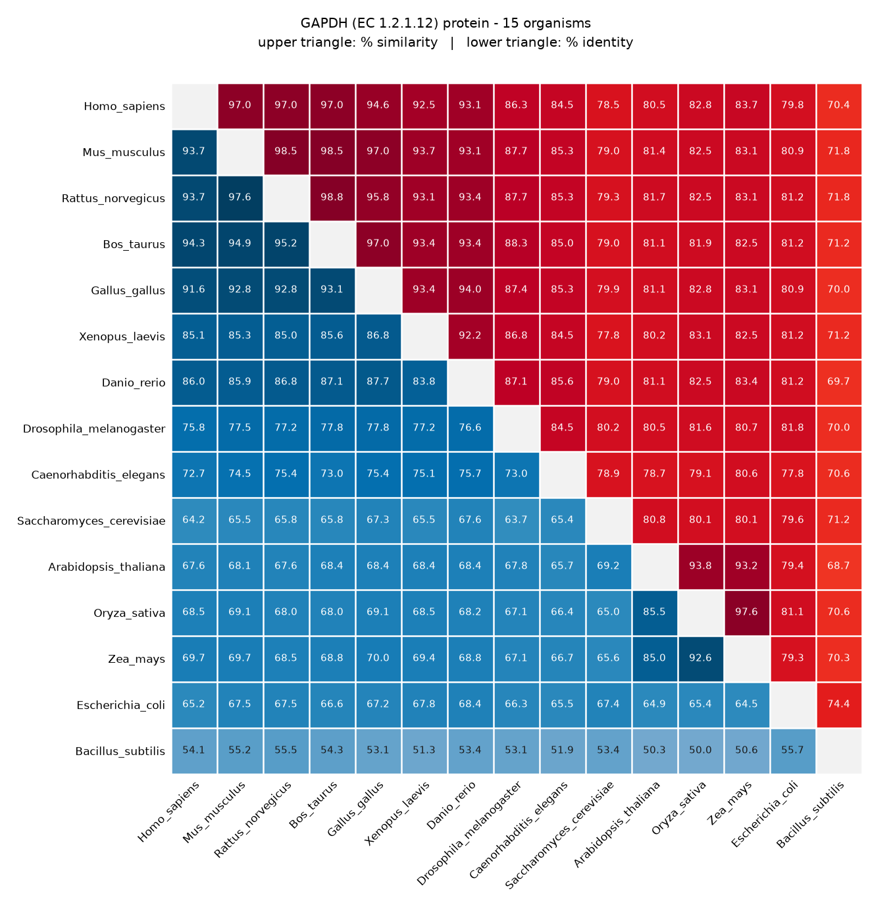
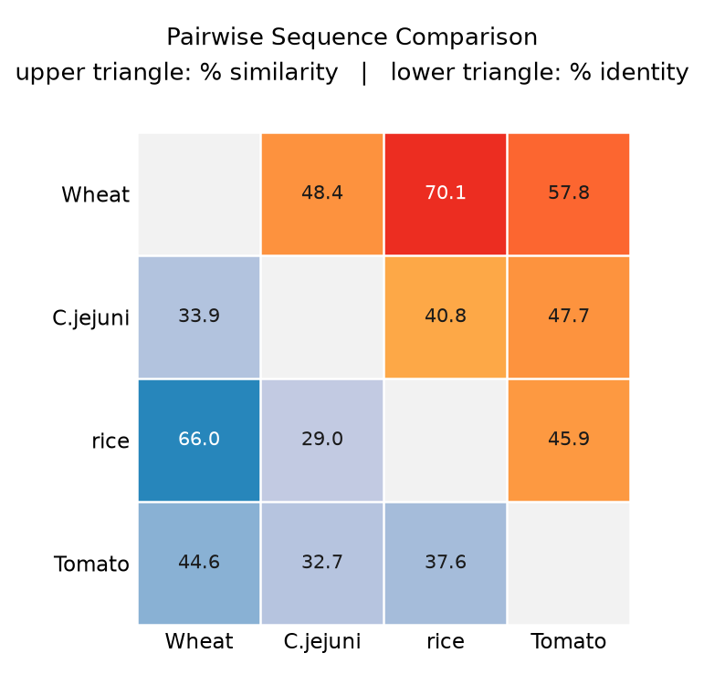
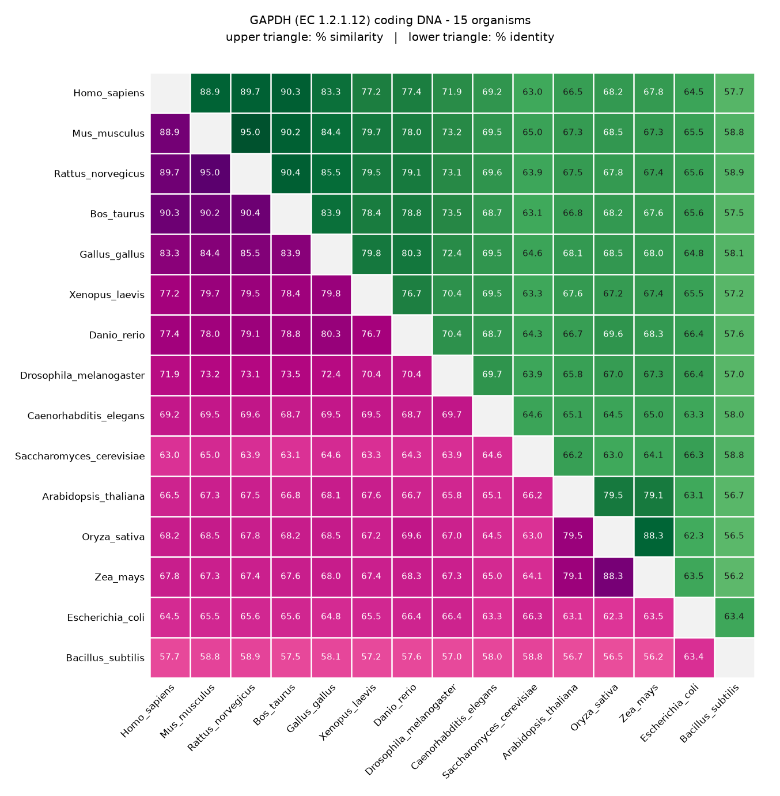

# seqAlign

**seqAlign** is a modern, memory-efficient Python command-line tool for
pairwise and all-vs-all **global sequence alignment** of proteins or nucleic
acids. For every pair of sequences it reports **percent identity** and
**percent similarity**, and for three or more sequences it draws a single
publication-ready **heatmap** — similarity in the upper triangle, identity in
the lower triangle, each in its own colors — in the spirit of MatGAT
(Campanella *et al.*, 2003).

It started as a from-scratch **Python port of the driver logic** of a
legacy C tool (`align.c`, derived from Pearson & Lipman's FASTA package);
see [Relationship to the original `align.c`](#relationship-to-the-original-alignc)
for exactly what was ported vs. reimplemented.

<p align="center">
  
</p>

---

## Contents

- [Features](#features)
- [Screenshots](#screenshots)
- [Installation](#installation)
- [Quick start](#quick-start)
- [Heatmap themes and labels](#heatmap-themes-and-labels)
- [Scoring matrices](#scoring-matrices)
- [CLI reference](#cli-reference)
- [Testing](#testing)
- [Relationship to the original `align.c`](#relationship-to-the-original-alignc)
- [Project layout](#project-layout)
- [Acknowledgements and references](#acknowledgements-and-references)
- [License](#license)

---

## Features

- **Global alignment** with two engines:
  - `affine` (Gotoh, 1982): exact, with affine gap penalties.
  - `linear-space` (Hirschberg, 1975): **O(min(n,m)) memory** for very long sequences (linear gap cost).
  - `auto` (default): picks one based on sequence length.
  - Each DP row is computed as a vectorized numpy operation, so typical genes and proteins align in a fraction of a second.
- **Bundled scoring matrices** for proteins (BLOSUM45/50/62/80/90, PAM30/70/250) and nucleic acids (simple +5/−4, NUC.4.4/EDNAFULL, BLASTN, transition/transversion). Any NCBI-format matrix file can also be used.
- **Percent identity and percent similarity** reporting (`-i`).
- **All-vs-all comparison**: pass 3 or more FASTA files and every pair is aligned once.
- **Heatmap** for 3+ sequences:
  - The upper triangle (similarity) and lower triangle (identity) use **different color maps**. Every cell shows its value, so no colorbar is needed.
  - **Six color themes** (`--theme`), plus custom matplotlib color maps per triangle.
  - Long organism or sample names are **drawn at an angle** automatically, and the layout is measured so that labels and title **never overlap**.
- Streaming FASTA parsing, input validation, and clear error messages for malformed files, mixed DNA and protein input, wrong matrix types, and missing dependencies.
- Fully type-hinted, modular package; pure Python plus numpy and matplotlib, so it runs on Windows, macOS and Linux.

---

## Screenshots

**Original example**: four plant and bacterial protein sequences (`examples/`):

<p align="center">
  
</p>

**Oxidoreductase test set: protein.** Glyceraldehyde-3-phosphate dehydrogenase
(GAPDH, EC 1.2.1.12) from 15 organisms, scored with BLOSUM50 and the default
`sunset-ocean` theme. Mammals, vertebrates and plants each form clear blocks,
and *Bacillus subtilis* is the most divergent:

<p align="center">
  
</p>

**Oxidoreductase test set: coding DNA.** The matching GAPDH coding sequences,
scored with NUC.4.4 and the `forest-berry` theme. Synonymous codon changes
make DNA identity noticeably lower than protein identity for distant species:

<p align="center">
  
</p>

See [Testing](#testing) for how these images are produced.

---

## Installation

seqAlign requires **Python 3.9+**. It needs no compiler and no
platform-specific build steps.

### 1. Get the code

```bash
git clone https://github.com/y-v-j/seqAlign.git
cd seqAlign
```

### 2. Install the dependencies

The runtime dependencies are just **numpy** and **matplotlib**:

```bash
pip install -r requirements.txt
```

Using a virtual environment is recommended:

```bash
python -m venv .venv
source .venv/bin/activate        # Windows: .venv\Scripts\activate
pip install -r requirements.txt
```

### 3. Install the package

```bash
pip install .            # regular install
# or
pip install -e .         # editable/development install
pip install -e ".[test]" # editable install + pytest for running the test suite
```

This installs the command-line tool under two names, `seqAlign` and
`seqalign`. You can also run the package without installing it:

```bash
python -m seqalign <files...>
```

Check that it works:

```bash
seqAlign --list-matrices
seqAlign --list-themes
```

---

## Quick start

Pairwise protein alignment with identity and similarity:

```bash
seqAlign examples/seq1.fasta examples/seq2.fasta -i
```

DNA sequences with only the scores (no alignment printout):

```bash
seqAlign examples/barley_dna.fasta examples/corn_dna.fasta -n -d -i
```

All-vs-all comparison with a heatmap:

```bash
seqAlign examples/wheat.fasta examples/jejuni.fasta examples/rice.fasta examples/tomato.fasta \
         -i -d --heatmap-output comparison.png
```

Choose a scoring matrix and a heatmap theme:

```bash
seqAlign examples/*_dna.fasta -i -d -s NUC.4.4 --theme colorblind --heatmap-output dna.png
```

Use the memory-efficient engine for very long sequences:

```bash
seqAlign chr_fragment1.fasta chr_fragment2.fasta --engine linear-space
```

Each input FASTA file contributes its **first** record. The first word of
the header becomes the sequence's label in the output and on the heatmap.

---

## Heatmap themes and labels

For 3+ input sequences, seqAlign computes every pairwise alignment once and
plots a single matrix:

| Region | Shows |
|---|---|
| **Upper triangle** | percent **similarity** |
| **Lower triangle** | percent **identity** |
| **Diagonal** | a sequence vs. itself (blank) |

Each triangle has its own color map, so the two measures can't be confused.
Every cell is labelled with its value, so the heatmap has no colorbar; the
colors are there to make clusters easy to spot.
Pick a theme with `--theme NAME`:

| Theme | Upper (similarity) | Lower (identity) | Notes |
|---|---|---|---|
| `sunset-ocean` | YlOrRd | PuBu | default |
| `classic` | Reds | Blues | |
| `forest-berry` | YlGn | RdPu | |
| `perceptual` | viridis | magma | perceptually uniform |
| `colorblind` | Oranges | Purples | safe for common color-vision deficiencies |
| `grayscale` | Greys | Greys_r | print-friendly |

You can override either half with any
[matplotlib colormap](https://matplotlib.org/stable/gallery/color/colormap_reference.html):

```bash
seqAlign a.fasta b.fasta c.fasta --theme classic --upper-cmap plasma
```

**Labels.** When any sequence name is wider than its column, the x-axis
labels are automatically angled at 45°. You can force a specific angle with
`--label-rotation DEG` (for example `0` or `90`). The figure is laid out by
measuring the rendered size of every label, and the title,
then placing them so that nothing overlaps. This holds for long names and
for many sequences; the test suite checks it for several layouts (see
`tests/test_heatmap.py`). Use `--title` to set the heatmap title and `--dpi`
to set the resolution.

---

## Scoring matrices

All matrices ship with the package in `seqalign/data/matrices/` (standard
NCBI-format text files). List them with `seqAlign --list-matrices`.

| Type | Name (`-s`) | Typical use |
|---|---|---|
| Protein | `BLOSUM45` | distantly related proteins |
| Protein | `BLOSUM50` | general purpose (**default for protein**) |
| Protein | `BLOSUM62` | NCBI BLASTP default; moderately related proteins |
| Protein | `BLOSUM80` | closely related proteins |
| Protein | `BLOSUM90` | very closely related proteins |
| Protein | `PAM30` | short, highly similar sequences |
| Protein | `PAM70` | similar sequences |
| Protein | `PAM250` | distantly related proteins (Dayhoff) |
| Nucleic acid | `DNA` | simple match +5 / mismatch −4 (**default for DNA/RNA**) |
| Nucleic acid | `NUC.4.4` (alias `EDNAFULL`) | +5/−4 with IUPAC ambiguity codes |
| Nucleic acid | `BLASTN` | NCBI BLASTN +2/−3 with IUPAC ambiguity codes |
| Nucleic acid | `TRANS` | transition/transversion matrix |

Notes:

- RNA is supported: `U` scores like `T`. Letters missing from a matrix
  score like its wildcard (`X` for protein, `N` for nucleotides).
- A protein matrix used with DNA (or vice versa) is rejected with a clear error.
- `-s path/to/my.mat` loads any NCBI-format matrix file, like the original tool's `-s` option.
- Default gap penalties are 12/2 (open/extend) for protein and 16/4 for
  DNA, following the original tool's `resetp()`. Override them with `-f` and `-g`.
- **Similarity** counts aligned columns that are identical or that have a
  positive score in the chosen matrix (the EMBOSS convention). With pure
  A/C/G/T sequences and a nucleotide matrix, similarity therefore equals
  identity.

---

## CLI reference

```
seqAlign FILE [FILE ...] [options]
```

| Flag | Meaning | Original flag |
|---|---|---|
| `-f, --gap-open PENALTY` | Gap opening penalty | `-f` |
| `-g, --gap-extend PENALTY` | Gap extension penalty | `-g` |
| `-m, --markx {0,3}` | Output format | `-m` |
| `-n, --dna` | Treat input as DNA/RNA | `-n` |
| `--protein` | Force protein interpretation | *(new)* |
| `-O, --output-file FILE` | Also write results to FILE | `-O` |
| `-s, --matrix NAME\|FILE` | Scoring matrix name or matrix file | `-s` |
| `--list-matrices` | List bundled scoring matrices and exit | *(new)* |
| `-w, --line-width N` | Alignment display width | `-w` |
| `-x, --offsets OFF0 OFF1` | Numbering offsets | `-x` |
| `-d, --no-display` | Suppress aligned-sequence display | `-d` |
| `-i, --similarity` | Also report percent similarity | `-i` |
| `-a, --num-sequences N` | (compat) validated against file count, not required | `-a` |
| `--engine {auto,affine,linear-space}` | Alignment algorithm | *(new)* |
| `--heatmap-output PATH` | Heatmap image path (default `heatmap.png`) | *(new)* |
| `--no-heatmap` | Skip heatmap generation | *(new)* |
| `--dpi N` | Heatmap resolution (default 150) | *(new)* |
| `--theme NAME` | Heatmap color theme (default `sunset-ocean`) | *(new)* |
| `--list-themes` | List heatmap themes and exit | *(new)* |
| `--upper-cmap CMAP` / `--lower-cmap CMAP` | Override a theme's color map for one triangle | *(new)* |
| `--label-rotation DEG` | Angle of the heatmap's x labels (default: auto) | *(new)* |
| `--title TEXT` | Heatmap title | *(new)* |

**Note on `-a`:** in the original, `-a` drove a manual off-by-one indexed
loop over `argv`. Here, `argparse` collects any number of positional file
arguments directly, so listing your files is enough. `-a` is kept only for
familiarity and backward compatibility; it is validated but has no other
effect.

---

## Testing

The test suite lives in `tests/` and uses pytest:

```bash
pip install -e ".[test]"
pytest
```

It covers:

| File | What it checks |
|---|---|
| `tests/test_matrices.py` | every bundled matrix loads; published values; RNA, case and unknown-residue handling; matrix/sequence type mismatch; custom matrix files |
| `tests/test_align.py` | both engines against a plain cell-by-cell reference implementation of the same recurrences; returned alignments really achieve the reported score |
| `tests/test_heatmap.py` | triangles use different color maps; all themes render; automatic label angling; **no overlap** between title, labels and heatmap for several layouts |
| `tests/test_oxidoreductases.py` | end-to-end run on real oxidoreductase data (below) |

### Oxidoreductase (GAPDH) example: 15 organisms

The folder `tests/oxidoreductases/` holds the Python code for this example.
It is kept separate from the installed package and uses only seqAlign and
the Python standard library:

| Script | Purpose |
|---|---|
| `download_sequences.py` | downloads the protein and coding-DNA sequences |
| `run_gapdh_comparison.py` | runs the all-vs-all comparisons and draws both heatmaps |

#### Run the example

From the repository root (seqAlign does not need to be installed):

```bash
python tests/oxidoreductases/run_gapdh_comparison.py
```

This aligns all 105 pairs of the 15 protein sequences (BLOSUM50) and of
the 15 coding-DNA sequences (NUC.4.4); each takes a few seconds. It writes:

- `docs/images/oxidoreductase_protein_heatmap.png` and `docs/images/oxidoreductase_dna_heatmap.png`
  (the images in [Screenshots](#screenshots))
- `tests/data/oxidoreductases/results_protein.txt` and `results_dna.txt`
  (the full text results)

Useful options:

```bash
python tests/oxidoreductases/run_gapdh_comparison.py --outdir my_results    # write everything to my_results/
python tests/oxidoreductases/run_gapdh_comparison.py --protein-theme classic --dna-theme colorblind
python tests/oxidoreductases/run_gapdh_comparison.py --only protein -v      # protein only, print every alignment score
python tests/oxidoreductases/run_gapdh_comparison.py --download            # re-download the sequences first
```

#### The test data

`download_sequences.py` downloads the **protein and coding-DNA sequences** of an
oxidoreductase (EC class 1) for **15 organisms**: human, mouse, rat, cow,
chicken, *Xenopus*, zebrafish, *Drosophila*, *C. elegans*, budding yeast,
*Arabidopsis*, rice, maize, *E. coli* and *B. subtilis*.

- The default enzyme is **glyceraldehyde-3-phosphate dehydrogenase
  (GAPDH, EC 1.2.1.12)**, an NAD-dependent oxidoreductase that is
  conserved across all domains of life.
- Proteins come from reviewed **UniProtKB/Swiss-Prot** entries. The script
  prefers the main cytosolic enzyme over tissue- or organelle-specific paralogs.
- Coding sequences come from the entry's **EMBL/ENA** cross-reference, with
  **NCBI** as a fallback. Each CDS is **translated and checked against the
  UniProt protein** before it is accepted.
- Files are written to `tests/data/oxidoreductases/{protein,dna}/<Organism>.fasta`,
  with a `manifest.tsv` that records every accession. The downloaded data is
  committed, so the tests run offline.

```bash
python tests/oxidoreductases/download_sequences.py              # GAPDH (default)
python tests/oxidoreductases/download_sequences.py --ec 1.15.1.1 --outdir /tmp/sod   # e.g. superoxide dismutase
```

The `comparison.png` example at the top of [Screenshots](#screenshots) is
produced with:

```bash
seqAlign examples/wheat.fasta examples/jejuni.fasta examples/rice.fasta examples/tomato.fasta \
         -i -d --heatmap-output comparison.png
```

---

## Relationship to the original `align.c`

`align.c`, as provided, is **only the driver**: `main()`, `initenv()`
(option parsing), `resetp()`, `initpam2()` and `calcons()`. It calls
functions defined in files that were not available:

| Missing piece | Role | Where it lived |
|---|---|---|
| `ALIGN()` | The actual Myers–Miller alignment algorithm | `llmax.c` |
| `getseq()` / `gettitle()` | Sequence file parsing | `nxgetaa.c` |
| `initpam()` + PAM tables | Scoring matrix loading | `pam.c`, `upam.gbl` |
| `discons()` | Alignment display formatting | `ndispn.c` |
| `CHECK_SIMILARITY()` | Similarity scoring | not identifiable in the given build recipe |

**What was ported faithfully** (same control flow and semantics, translated to Python):

- The all-vs-all nested-loop structure over input files (`main()`'s `for(k) for(kj=k+1)`).
- `calcons()`'s identity bookkeeping (`nd`/`nc` → `identical`/`aligned_length`); see `consensus.score_alignment()`.
- `resetp()`'s DNA vs. protein gap-penalty defaults; see `matrices.get_scoring_scheme()`.
- The CLI flag set and its semantics; see `cli.py`.

**What was reimplemented from scratch** (because the source wasn't available):

- **The alignment algorithm itself** (`align.py`): standard, published Gotoh
  affine-gap dynamic programming and Hirschberg's linear-space
  divide-and-conquer technique. It is not a port of `ALIGN()`/Myers–Miller,
  which this repository never had access to.
- **Scoring matrices**: the standard published NCBI tables, bundled as data
  files, not `pam.c`'s compiled-in data.
- **FASTA parsing** (`io_utils.py`): a standard, validated FASTA reader, not a port of `nxgetaa.c`.
- **Similarity scoring**: `CHECK_SIMILARITY()`'s source was never provided,
  so similarity uses the standard bioinformatics convention (as in EMBOSS
  `needle`/`water`). A column counts as "similar" if it is an identity or
  the substitution matrix score for that pair is positive.

### A note on the two alignment engines

Real Myers–Miller performs linear-space alignment **with affine gap
costs** by running two coupled Gotoh recurrences (forward and reverse)
through the Hirschberg split. That coupling is intricate enough that a
fast, unverified reimplementation risks being subtly wrong. Rather than
ship that risk, this project offers:

- `affine`: exact affine-gap alignment, with O(n·m) memory (fine up to a
  few thousand residues per sequence on a typical machine).
- `linear-space`: true O(min(n,m)) memory via Hirschberg's algorithm, with
  a **linear** (not affine) gap cost. This is the well-established, correct
  way to get linear-space alignment without the added complexity.

`auto` (the default) switches to `linear-space` once either sequence
exceeds about 4000 residues.

---

## Error handling

The CLI fails fast with actionable messages for:

- Missing or unreadable input files
- Empty files, or files with no FASTA header
- Sequences with characters outside the expected DNA/protein alphabet
  (with a hint to pass `--dna`/`--protein` if auto-detection guessed wrong)
- A mix of nucleotide and protein inputs
- Unknown scoring matrices, or a protein matrix used with DNA (and vice versa)
- Unknown heatmap themes or color maps (checked before any alignment runs)
- Fewer than two valid sequences
- Missing `matplotlib`, with the exact `pip install` command to fix it; this
  is reported only when a heatmap is actually needed

---

## Project layout

```
seqAlign/
├── seqalign/                   # the Python package
│   ├── __init__.py
│   ├── __main__.py             # `python -m seqalign`
│   ├── cli.py                  # argument parsing + orchestration (align.c's main())
│   ├── align.py                # alignment engines (Gotoh affine / Hirschberg)
│   ├── consensus.py            # identity/similarity scoring + display (calcons/discons)
│   ├── io_utils.py             # FASTA reading + validation (getseq)
│   ├── matrices.py             # scoring-matrix loading
│   ├── heatmap.py              # themed multi-sequence heatmap rendering
│   └── data/matrices/          # bundled BLOSUM/PAM/NUC.4.4/BLASTN/TRANS matrices
├── tests/
│   ├── oxidoreductases/
│   │   ├── download_sequences.py   # GAPDH test-data downloader (separate from the package)
│   │   └── run_gapdh_comparison.py # runnable 15-organism GAPDH example
│   ├── data/oxidoreductases/       # downloaded GAPDH protein + DNA FASTA, manifest, results
│   ├── test_align.py
│   ├── test_heatmap.py
│   ├── test_matrices.py
│   └── test_oxidoreductases.py
├── examples/                   # sample FASTA files
├── docs/images/                # heatmap screenshots used in this README
├── comparison.png              # heatmap of the original examples
├── requirements.txt
└── pyproject.toml
```

---

## Acknowledgements and references

seqAlign's identity/similarity matrix output was inspired by **MatGAT**:

> Campanella J.J., Bitincka L., Smalley J. **MatGAT: An application that
> generates similarity/identity matrices using protein or DNA sequences.**
> *BMC Bioinformatics* 4, 29 (2003). Available from:
> <http://www.biomedcentral.com/1471-2105/4/29>
> (doi: [10.1186/1471-2105-4-29](https://doi.org/10.1186/1471-2105-4-29))

Algorithms and data:

- Myers E.W., Miller W. Optimal alignments in linear space. *CABIOS* 4, 11–17 (1988). Referenced by the original `align.c`.
- Gotoh O. An improved algorithm for matching biological sequences. *J. Mol. Biol.* 162, 705–708 (1982).
- Hirschberg D.S. A linear space algorithm for computing maximal common subsequences. *Commun. ACM* 18, 341–343 (1975).
- Henikoff S., Henikoff J.G. Amino acid substitution matrices from protein blocks. *PNAS* 89, 10915–10919 (1992) (BLOSUM).
- Dayhoff M.O., Schwartz R.M., Orcutt B.C. A model of evolutionary change in proteins. *Atlas of Protein Sequence and Structure* 5, suppl. 3 (1978) (PAM).
- Pearson W.R., Lipman D.J. Improved tools for biological sequence comparison. *PNAS* 85, 2444–2448 (1988) (FASTA package, origin of `align.c`).
- Test sequences: [UniProt](https://www.uniprot.org), [ENA](https://www.ebi.ac.uk/ena) and [NCBI](https://www.ncbi.nlm.nih.gov).

---

## License

MIT. See the algorithmic notes above for original-work attribution
(Myers & Miller, CABIOS 1988, referenced by the original tool). The code in
this repository is an independent reimplementation.
